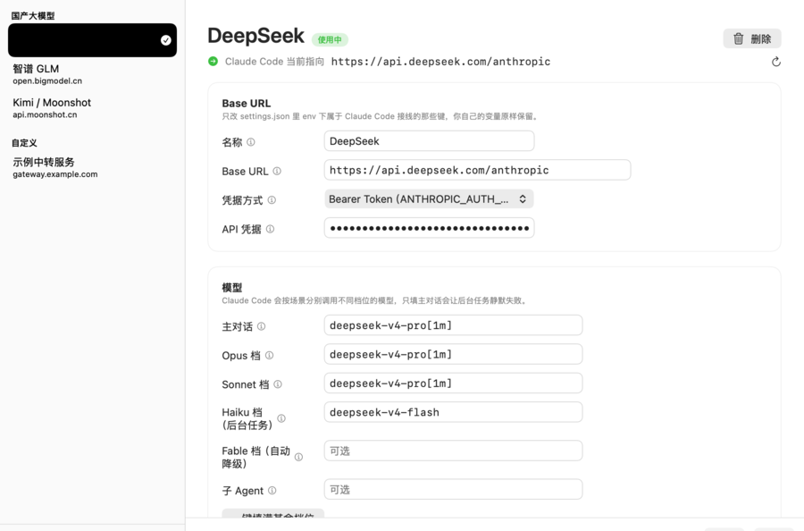
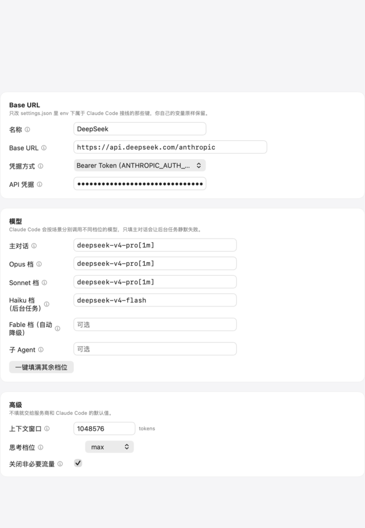

<div align="center">

# ClaudeBridger


**把终端里的 Claude Code 接到任何 Anthropic 兼容的模型服务，不用手改配置文件。**

填好「服务地址 + 凭据 + 模型」，点一下启用，配置就写好了。切换后端不用记字段，也不用怕改坏 Claude Code 的配置。

[](LICENSE)
[](https://www.apple.com/macos/)
[](https://swift.org)

[特色](#特色) · [截图](#截图) · [安装](#安装) · [快速开始](#快速开始) · [功能](#功能) · [配置说明](#配置说明) · [安全设计](#安全设计) · [常见问题](#常见问题) · [已知限制](#已知限制) · [许可证](#许可证)

**简体中文** · [English](./README_EN.md)

</div>

---

## 目录

- [它解决什么问题](#它解决什么问题)
- [特色](#特色)
- [截图](#截图)
- [适用范围](#适用范围)
- [它写哪两个文件](#它写哪两个文件)
- [安装](#安装)
- [快速开始](#快速开始)
- [功能](#功能)
- [配置说明](#配置说明)
- [安全设计](#安全设计)
- [支持的后端](#支持的后端)
- [常见问题](#常见问题)
- [从源码构建](#从源码构建)
- [已知限制](#已知限制)
- [许可证](#许可证)

---

## 1.0.1 修复了什么

三个问题的修复，都带回归测试：

- **重新打开 App 后右侧空白**：启动了已保存的配置，左侧列表显示选中，右侧却画的是空状态；点那一行也没反应。原因是启动时只恢复了选中项 id，没有装载对应的草稿，而右侧是按草稿渲染的——而且点「已经选中」的那一行，SwiftUI 不会触发选择回调，所以点不动。
- **删除没有确认**：删除现在会先弹确认框，明确写出「无法撤销」，并区分两种情况——删的是**正在使用**的后端时，会告诉你删除**不会**改回 Claude Code 的配置（那要用「恢复官方配置」）；删的是没在用的，会告诉你不会动配置文件。
- **新增模型显示名**：可以给 Opus / Sonnet / Haiku / Fable 四档设显示名（`ANTHROPIC_DEFAULT_*_MODEL_NAME`），只改 `/model` 选择器里显示的文字，不改变实际请求的模型。切换后端时旧的显示名会被清除，不会再出现「写着 MiniMax，实际请求 DeepSeek」这种名不副实的情况。

> 这四个键是**专门**存在的：Claude Code 没有 `ANTHROPIC_MODEL_NAME`，也没有子 Agent 的显示名变量，所以主对话和子 Agent 两档不显示这个输入框——而不是写一个 Claude Code 会忽略的键。

---

## 它解决什么问题

Claude Code 只认 Anthropic Messages API。任何能说这个协议的服务都能当它的后端，切换方式是把 `ANTHROPIC_BASE_URL` 之类的环境变量写进配置文件。听起来简单，实际手动做的时候每一步都有坑：

| 坑 | 后果 |
| --- | --- |
| 手改 JSON 少一个逗号 | 整个 `settings.json` 失效，连带权限、hooks 一起失效 |
| 不知道该配哪些变量 | 只配了主模型，后台摘要和子 Agent 静默失败 |
| 换后端时残留了 `ANTHROPIC_API_KEY` | 它和 `ANTHROPIC_AUTH_TOKEN` 冲突，报 401 |
| `base_url` 结尾多写了 `/v1` | 请求打到 `/v1/v1/messages`，报错像服务端的问题 |
| 首次用第三方端点被要求登录 | 那个开关在**另一个文件**里，很难想到 |
| 以为桌面版也能这么配 | 桌面版根本不读 `settings.json` 的 `env` |

ClaudeBridger 把这一串变成一次点击，并且在写入前备份、写入后回读校验。

## 特色

**只改接线用的那 12 个环境变量键，其余逐字节保留。**
`env` 块是 Claude Code 给自己和它启动的每个子进程用的通用环境变量区，用户完全可能在里面放代理设置、超时、自己的变量。内置的 JSON 编辑器记录每个值在原文里的字节区间，只替换被点名的区间——改一个值只动一行，加一个键只插一行。有测试断言「替换后与原文相比只差一行」。用户手写的注释、拖尾逗号、缩进风格全部原样活着。

**每次写入前自动备份，包括在软件自己管理的两个后端之间切换。**
唯一的破坏性操作也有退路。备份文件名带后端标识和时间戳，同一分钟内连续备份自动加序号，不覆盖。

**写完回读校验。**
「写入调用返回了」和「文件里确实是这个」是两回事。写入后重新读磁盘，比对 `base_url`、每个档位的模型名、凭据变量是否真的落地，只有一致才报成功。

**读不懂就停手，不「修复」。**
`settings.json` 解析不了、或者 `env` 存在但不是对象时，**拒绝写入并报错**。一个有 bug 的工具能造成的最坏结果，就是它「帮你修好」了它读不懂的配置——那等于丢掉用户的数据。解析不了的 `~/.claude.json`（里面有登录态和 MCP 配置）也会被跳过，只报警告。

**一次填满所有模型档位。**
Claude Code 按场景分别调用不同档位的模型，只配主对话会让后台任务静默失败——DeepSeek 和 Kimi 的官方接入文档都专门警告过这一点。所以每个档位都是一个独立字段，预设一次性填满，表单里还有「一键填满其余档位」。

## 截图

<p align="center">
  
</p>

<p align="center">
  
</p>

界面使用中英双语，跟随系统语言。

## 适用范围

**只支持终端里的 Claude Code CLI。**

如果你要接的是 Claude 桌面版 App（Chat / Cowork / Code 三个页签那个），这个软件帮不上忙。官方文档明确说明：桌面版的路由来自它自己的「第三方推理配置」（`inferenceProvider: gateway`、macOS 的 `.mobileconfig` 描述文件或 Windows 注册表策略），**不读 `ANTHROPIC_BASE_URL`，也不读 `settings.json` 的 `env`**。那是另一套机制。

另外，桌面版从 1.6259.1 起只接受命名上像 Anthropic 模型的 ID（以 `claude-` 或 `anthropic` 开头），接国产模型还需要额外做模型名映射。CLI 没有这个限制。

## 它写哪两个文件

| 文件 | 位置 | 作用 |
| --- | --- | --- |
| `settings.json` | `~/.claude/settings.json` | `env` 块里的端点、凭据、各档位模型 |
| `.claude.json` | `~/.claude.json` | 只写一个键：`hasCompletedOnboarding: true` |

第二个文件只为了跳过首次登录校验。不设这个键，用第三方端点启动 CLI 时它会先尝试连 Anthropic 官方做验证。它**不是** `~/.claude/settings.json`，是同级的另一个文件——这是很多人第一次配置时踩的坑。

设置 `CLAUDE_CONFIG_DIR` 会改变第一个文件的位置，ClaudeBridger 跟随这个变量（这也是测试用来跑在临时目录里的机制）。

> **一处未实测的不确定**：官方文档说 `CLAUDE_CONFIG_DIR` 决定「每个 `~/.claude` 路径」的位置，但没说同级的 `~/.claude.json` 是否也跟着走。ClaudeBridger 目前按文档字面把它当作留在用户主目录。如果你的环境实测不是这样，代码里 `ClaudePaths.claudeJSONOverride` 就是为此留的入口。

## 安装

### 下载

从 [Releases](https://github.com/panando/ClaudeBridger/releases) 下载 `ClaudeBridger-1.0.0.dmg`，打开后把 ClaudeBridger 拖进「应用程序」文件夹。

### 首次打开会被系统拦下（当前没有开发者签名）

软件使用**临时签名（ad-hoc signature）**，没有用 Apple 开发者证书签名，也没有经过 Apple 公证（notarization）。因此 macOS 的 Gatekeeper 可能弹出下面**两种提示之一**：

> "ClaudeBridger"已损坏，无法打开。你应该将它移到废纸篓。

> "ClaudeBridger"无法打开，因为无法验证开发者。

**这通常不代表软件真的损坏了。** 它的含义是：macOS 给一个「从网上下载、又没有经过公证」的 App 打上了隔离标记（quarantine flag）。

#### 方法一：在「系统设置」里放行（推荐，不用命令行）

1. 先双击打开一次 ClaudeBridger（会被拦下）。
2. 打开 **系统设置 → 隐私与安全性**。
3. 在「安全性」一栏里，会看到刚才关于 ClaudeBridger 的提示。
4. 点 **仍要打开**。
5. 在弹窗里确认打开。

#### 方法二：用「终端」清除隔离标记

如果「仍要打开」没有出现，或者系统仍然提示「已损坏」，请先把 `ClaudeBridger.app` 拖进**应用程序**文件夹，然后打开「终端」，执行：

```bash
sudo xattr -dr com.apple.quarantine /Applications/ClaudeBridger.app
```

输入你的 Mac 登录密码后按回车（**输入时终端不会显示任何字符，这是正常的**），然后再打开 ClaudeBridger 即可。

### 系统要求

macOS 14.0 或更高。当前构建为 Apple Silicon（arm64）单架构。

## 快速开始

1. 打开 ClaudeBridger，点左下角 **＋ 新建后端**，从列表里选一个服务商（比如 DeepSeek）。
2. 填入从服务商开放平台拿到的 **API 凭据**。
3. 点 **启用**。

完成后，Claude Code 就已经指向这个后端了。在终端里随便跑一句验证：

```bash
claude "你好"
```

想确认配置到底写成了什么，在 Claude Code 里执行 `/status`，看 `Anthropic base URL` 那一行。

## 功能

- **多后端管理**：左侧列表按「国产大模型 / 自定义」分组，当前使用中的后端带绿色对勾。
- **一键新建**：内置 DeepSeek、智谱 GLM、Kimi（开放平台与会员订阅）、阿里云百炼通义、自定义共六个预设，每个都带出处说明，模型档位一次性填满。
- **实时状态**：顶部始终显示 Claude Code 当前指向的地址。这个值**从文件里读**，不来自软件自己的记录——所以如果你在别处手动改了 `settings.json`，这里会如实反映出来。
- **切换保护**：如果当前指向的是一个本软件不管理的地址（比如你手写的配置），启用新后端前会弹确认框，并告诉你原文件会被备份。
- **删除保护**：删除后端前一定先确认，并说明后果。删的是正在使用的后端时，会明确告诉你删除**不会**改回 Claude Code 的配置。
- **恢复官方配置**：一键清除 `settings.json` 里 ClaudeBridger 写入的所有键，回到官方默认。同样先备份。
- **地址校验**：表单里当场警告三种会出问题的地址——结尾带 `/v1`、指向本机、用明文 `http` 发送凭据。
- **保存与启用分离**：`保存` 只写 ClaudeBridger 自己的记录文件，不碰任何 Claude Code 读的文件；`启用` 才写入并备份。改了设置但没保存时，启用按钮会禁用并说明原因。

## 配置说明

### 写入的环境变量

ClaudeBridger 只会写下面这些键。`env` 块里其他任何东西都不动。

| 环境变量 | 来源 |
| --- | --- |
| `ANTHROPIC_BASE_URL` | 表单里的 Base URL |
| `ANTHROPIC_AUTH_TOKEN` | 凭据（选 Bearer Token 方式时） |
| `ANTHROPIC_API_KEY` | 凭据（选 API Key 方式时） |
| `ANTHROPIC_MODEL` | 主对话 |
| `ANTHROPIC_DEFAULT_OPUS_MODEL` | Opus 档 |
| `ANTHROPIC_DEFAULT_OPUS_MODEL_NAME` | Opus 档的显示名（只影响 `/model` 选择器） |
| `ANTHROPIC_DEFAULT_SONNET_MODEL` | Sonnet 档 |
| `ANTHROPIC_DEFAULT_SONNET_MODEL_NAME` | Sonnet 档的显示名（只影响 `/model` 选择器） |
| `ANTHROPIC_DEFAULT_HAIKU_MODEL` | Haiku 档（后台任务） |
| `ANTHROPIC_DEFAULT_HAIKU_MODEL_NAME` | Haiku 档的显示名（只影响 `/model` 选择器） |
| `ANTHROPIC_DEFAULT_FABLE_MODEL` | Fable 档（自动降级） |
| `ANTHROPIC_DEFAULT_FABLE_MODEL_NAME` | Fable 档的显示名（只影响 `/model` 选择器） |
| `CLAUDE_CODE_SUBAGENT_MODEL` | 子 Agent |
| `CLAUDE_CODE_AUTO_COMPACT_WINDOW` | 上下文窗口 |
| `CLAUDE_CODE_MAX_CONTEXT_TOKENS` | 上下文窗口 |
| `CLAUDE_CODE_DISABLE_NONESSENTIAL_TRAFFIC` | 「关闭非必要流量」开关 |
| `CLAUDE_CODE_EFFORT_LEVEL` | 思考档位 |

`ANTHROPIC_API_KEY` 特殊：**只能被清除，永远不会被写入**。它和 `ANTHROPIC_AUTH_TOKEN` 同时存在会导致 401，所以切换到 Bearer Token 方式时总会把残留的那个清掉。

### Base URL 不要带 `/v1`

Claude Code 会自己拼上 `/v1/messages`。给 `https://api.example.com/v1` 会变成请求 `/v1/v1/messages`——这个失败最难排查，因为它看起来像服务端的问题。表单会当场警告。

### 关于 `[1m]` 后缀

各厂商文档推荐写 `deepseek-v4-pro[1m]` 这样的名字。实测确认：**这个后缀是客户端侧的提示，Claude Code 会在发请求前把它剥掉**。用真实的 Claude Code v2.1.299 抓包验证：配置里写的是 `deepseek-v4-pro[1m]`，本地抓到的请求体里是 `"model": "deepseek-v4-pro"`。所以服务商看到的是干净的名字，后缀只用来告诉 Claude Code 上下文窗口有多大。

### 上下文窗口那一栏

对应 `CLAUDE_CODE_AUTO_COMPACT_WINDOW` 和 `CLAUDE_CODE_MAX_CONTEXT_TOKENS`。**填错会导致过早压缩上下文、或者超出上限报错**，不确定就留空，交给模型自身的默认值。

## 安全设计

这一节是这个软件唯一值得细看的部分，因为它做的每件事都是「替换你正在用的配置」。

### 只改属于接线的那几个键

见上面的变量表。其余一切——`HTTPS_PROXY`、`API_TIMEOUT_MS`、`permissions`、`hooks`、`statusLine`、你自己定义的变量——逐字节保留。这是实测的：一个测试断言「替换一个值后，与原文相比只差一行」。

### 拒绝，而不是「修复」

解析失败就停止写入。理由见[上面的特色](#特色)。

### 每次都先备份，没有例外

写入前，`settings.json` 和 `~/.claude.json` 都会被复制到：

```
~/.claude/claudebridger/backup/settings-<后端>-yyyy-MM-dd-HHmm-bak.json
~/.claude/claudebridger/backup/claude-json-<后端>-yyyy-MM-dd-HHmm-bak.json
```

备份目录故意**不叫** `~/.claude/backups/`——那是 Claude Code 自己放轮转的 `.claude.json.backup.*` 文件的地方，两个写入方共用目录迟早互相删文件。

### 凭据的存放

凭据写在 `~/.claude/claudebridger/credentials.json`，权限 `0600`。

**没有用 Keychain，这是有意的权衡**：本软件是临时签名、未公证的，未签名二进制读 Keychain 会弹窗，而「始终允许」绑定在代码签名上，每次重新构建都会变——用户每次更新都要重新授权一次，比它解决的问题更烦人。

这个文件**不是**强密钥存储，代码里也没有假装它是。它的意义是：凭据不落在你会提交的仓库里、不和团队共享的项目配置文件里、也不会出现在一个设置软件必然会被截图的那一屏。

必须说清楚：**`ANTHROPIC_AUTH_TOKEN` 最终还是会以明文写进 `settings.json`，因为那才是 Claude Code 读的文件。** 官方文档对此有专门警告。ClaudeBridger 做不到让那个文件变秘密，它能做的是不额外多存一份在别的地方。

## 支持的后端

预设只在端点的 Anthropic 兼容性可从厂商官方文档确认时才收录，每条都带出处。**模型名变动极快，填入前请到厂商文档确认当前可用的模型名。**

| 后端 | Base URL |
| --- | --- |
| DeepSeek | `https://api.deepseek.com/anthropic` |
| 智谱 GLM | `https://open.bigmodel.cn/api/anthropic` |
| Kimi / Moonshot 开放平台 | `https://api.moonshot.cn/anthropic` |
| Kimi Code（会员订阅） | `https://api.kimi.com/coding/` |
| 阿里云百炼 · 通义 Qwen | `https://dashscope.aliyuncs.com/apps/anthropic` |
| 自定义 / 中转服务 | 任何实现了 Anthropic Messages API 的服务 |

百炼和 Kimi 都有多套计费方式，**每套的 base URL 和专属 Key 必须配套使用**，混用会报鉴权失败。表单里的说明写了这一点。

DeepSeek 还有个额外便利：官方会把 `claude-opus*` 映射到自家 pro 模型、`claude-sonnet*` 和 `claude-haiku*` 映射到 flash 模型，所以即使模型名没配对也能跑起来。

## 常见问题

**启用后 Claude Code 报 401？**
检查凭据方式。如果服务端认的是 `x-api-key` 头，就要把「凭据方式」从 Bearer Token 改成 API Key，反之亦然。另外确认这个 Key 和 base URL 是配套的——百炼和 Kimi 的不同计费方案各有专属端点，混用必然 401。

**启用后报模型不存在？**
模型名写错了。到服务商文档确认当前可用的名字。注意 `[1m]` 后缀不影响这一点（它会被剥掉），但模型主体名字必须对。

**后台任务（比如生成对话标题）失败？**
Haiku 档没配。它对应 `ANTHROPIC_DEFAULT_HAIKU_MODEL`，专门给后台任务用。

**我手改过 `settings.json`，现在顶部的地址不对？**
点顶部那行的刷新按钮，或者 `⌘R`，重新读磁盘。

**为什么「启用」按钮是灰的？**
把鼠标停在上面会说明原因。常见两种：改了设置还没保存；或者这个后端正在使用且文件里就是这套设置——这时候没有东西需要写入，按钮就平了。

**能同时配两个后端来回切吗？**
可以，左侧列表点选即切换。两个都由本软件管理时不会弹确认框。

**桌面版 App 能用吗？**
不能，见[适用范围](#适用范围)。

## 从源码构建

需要 Xcode 命令行工具（Swift 5.9+）。

```bash
swift build            # 构建
swift test             # 129 个测试
swift run ClaudeBridger
```

无外部依赖：JSON、文件 IO、SwiftUI 全部来自系统。

打包：

```bash
./scripts/build-app.sh     # 产出 build/ClaudeBridger.app
./scripts/build-dmg.sh     # 产出 build/ClaudeBridger-1.0.0.dmg
```

`build-dmg.sh` 会在打包后把 DMG 挂载回来校验：确认里面的可执行文件在、`/Applications` 符号链接在、版本号与 `VERSION` 一致。

### 测试

测试全部跑在临时目录里（通过 `CLAUDE_CONFIG_DIR` 指向一个假家目录），**不会碰到你真实的 `~/.claude`**。

```bash
swift test
```

值得单独跑的几组，因为它们守护的是这个软件存在的理由：

```bash
swift test --filter JSONDocumentTests          # 编辑器只动该动的字节
swift test --filter ClaudeSettingsWriterTests  # 用户的配置在切换后完好
swift test --filter ManagedEnvironmentTests    # 安全边界没有被悄悄放宽
swift test --filter AppModelTests              # 哪个动作写哪个文件
```

## 已知限制

- **只接 CLI。** 桌面版 App 走的是另一套机制，见[适用范围](#适用范围)。
- **走第三方端点时，Claude Code 的一些功能会失效。** 这是 Claude Code 自身的行为：`ANTHROPIC_BASE_URL` 指向非官方主机后，MCP tool search 默认关闭、Remote Control 不可用、定价显示不正常。
- **Anthropic 对第三方网关的态度是「不禁止但不支持」。** 官方文档原话是不背书、不维护、不审计第三方网关，也不支持通过任何网关把 Claude Code 路由到非 Claude 模型。而且历史上逐步收紧过：桌面版加过模型名白名单，CLI 把网关模型发现从默认开启改成手动 opt-in。依赖这条路要有被收紧的心理准备。
- **内置预设里的模型名会过期。** 端点相对稳定，模型名不是。
- **未公证。** 首次打开需要手动放行，见[安装](#安装)。
- **`CLAUDE_CONFIG_DIR` 是否也迁移 `~/.claude.json`：未实测**，见[它写哪两个文件](#它写哪两个文件)。
- **不能反向导入。** 目前只能从预设新建后端，无法读取你已有的 `settings.json` 并识别成一个后端。

## 已实测验证的部分

不是「照着文档写的」，这几条是跑出来的：

- 用真实 Claude Code CLI **v2.1.299** 对着 ClaudeBridger 生成的配置启动，请求确实发往配置里的地址。
- 抓包确认请求路径是 `/v1/messages?beta=true`，鉴权头是 `Authorization: Bearer <token>`。
- 确认 `deepseek-v4-pro[1m]` 的 `[1m]` 后缀由 CLI 在发请求前剥掉，服务商收到 `deepseek-v4-pro`。
- 写入后 `$schema`、`permissions`、用户自定义的 `env` 变量逐字节保留。

## 许可证

[MIT](LICENSE)

Copyright (c) 2026 panando
